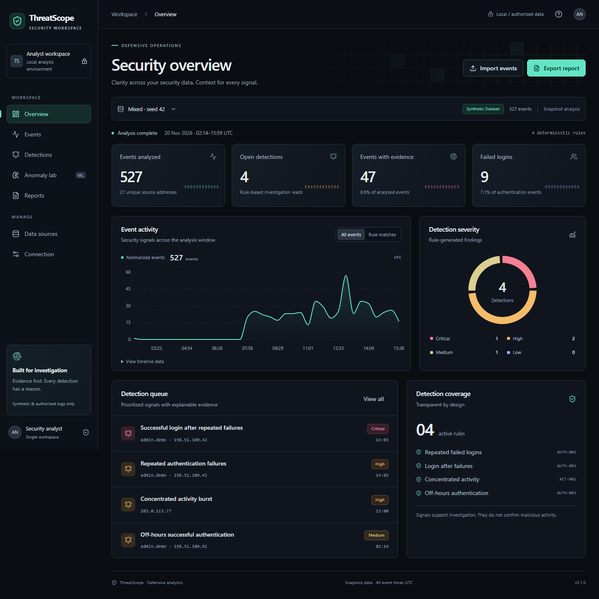
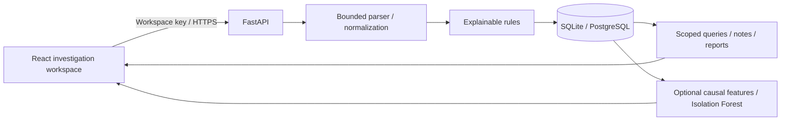

# ThreatScope

**Evidence first. Context for every signal.**

A defensive security analytics workspace with a React command center, FastAPI analysis engine, explainable detections, and an optional Isolation Forest anomaly lab. Analyze synthetic demonstrations or authorized CSV/JSON logs; investigate supporting events, persist notes and triage decisions, then export reviewable evidence.



## Main features

- Responsive obsidian/teal dashboard with interactive event-volume and severity charts, accessible data tables, Motion transitions, animated counters and reduced-motion support.
- Searchable, filterable, paginated event explorer with normalized event/JSON inspection.
- Four deterministic rules: repeated login failures, success after failures, concentrated activity, and off-hours authentication. Every alert explains its threshold, evidence and possible false positives.
- Optional reproducible Isolation Forest scoring, feature context, and measured rules-vs-ML evaluation with confusion matrices.
- Five seeded synthetic scenarios, strict bounded uploads, atomic dataset storage, investigation notes and triage status.
- JSON investigation reports and complete CSV event exports, including spreadsheet formula protection.
- SQLite locally; PostgreSQL configuration and integration checks for persistent deployment. Production workspace-key access, explicit CORS and bounded request handling.

No live collection, external network scanning, exploitation or automated incident response. Snapshot data is labeled honestly. This is a small, shared investigation workspace, not an enterprise SIEM or a validated malicious-activity classifier.

## Frontend and backend installation

Requirements: **Node 24**, **uv**, and Python **3.12 or 3.13**. uv can install the Python runtime. Run commands from the repository root.

```powershell
uv sync --frozen
npm ci
Copy-Item .env.example .env
```

Start the API in one terminal:

```powershell
uv run uvicorn threatscope.main:app --app-dir backend --host 127.0.0.1 --port 8000
```

Start the frontend in another:

```powershell
npm run dev
```

Open **http://127.0.0.1:5173** and choose **Launch demo workspace**. The first scenario analyzes 527 synthetic events and produces four explained findings. Or use **Import events** with [the bundled samples](sample-data/README.md). All displayed event times are UTC; no real-time telemetry is implied.

The Vite development server proxies `/api` to loopback port 8000. SQLite persists to the ignored `threatscope.db` file. For local key-protected access, set `API_KEY` in `.env`, restart the API, and enter the key through **Connection**. Keys remain only in browser memory and are cleared on reload. Keep keyless development bound to loopback.

On macOS/Linux replace the copy command with `cp .env.example .env`; the run commands otherwise work unchanged.

## Incident Replay Lab walkthrough

**Current capability:** the scenario-based investigation workflow below is available. Timed play/pause, stepping, speed controls and replay-time alert emission are not implemented in this checkout; they remain planned. This refactor does not rebuild the product.

1. Load **Command center** from **Data sources → Demo scenarios**. A fixed seed makes the dataset reproducible.
2. Open **Detections → Investigate** on the successful-login-after-failures finding.
3. Review the reason, threshold evidence and supporting events. Add verified context and change the status.
4. Use **Events** to search a source/user and inspect normalized event content.
5. Optionally run **Anomaly lab**. Treat unusual scores as candidates requiring verification.
6. Export the **JSON investigation report** and **event CSV** from **Reports**.

## Testing instructions

```powershell
uv run ruff check backend scripts
uv run ruff format --check backend scripts
uv run pytest --cov=threatscope --cov-report=term-missing
npm run lint
npm run format:check
npm run typecheck
npm test
npm run build
```

Full-stack browser tests start isolated API/frontend processes on ports 8001/5174 and use an in-memory synthetic test database:

```powershell
$env:PLAYWRIGHT_BROWSERS_PATH = Join-Path $PWD '.playwright'
npx playwright install chromium
npm run test:e2e
```

On Linux/macOS use `export PLAYWRIGHT_BROWSERS_PATH="$PWD/.playwright"` first. Linux hosts may require `npx playwright install --with-deps chromium`.

GitHub Actions adds an isolated PostgreSQL service and checks artifact reproducibility and dependency advisories. Local PostgreSQL integration is skipped unless `TEST_POSTGRES_URL` points to an isolated test database. See [progress and actual verification results](docs/development/PROGRESS.md).

## What-if Detection Lab

The four deterministic rule thresholds are currently fixed. A bounded configuration comparison API and original-versus-modified UI are planned, not available controls. Do not treat changing source constants as an interactive lab. See [lab status and walkthrough](docs/product/INCIDENT_LABS.md).

## ML methodology and honest evaluation

The checked-in evaluation uses 1,920 independent benign training events and 15 held-out synthetic datasets (7,482 events). Measured Isolation Forest **precision: 0.252874**, **recall: 0.234043**. The rules score 1.0/1.0 on labels deliberately designed around those rules; neither result establishes real-world effectiveness. The ML model produces substantial false positives and misses and remains optional.

See [methodology, feature definitions and confusion matrices](docs/ml/README.md) and [the generated JSON artifact](docs/ml/evaluation.json). Scores measure unusualness, not the probability that an event is malicious.

## Architecture diagram



## Technology stack

Frontend: React, TypeScript, Vite, Tailwind, owned shadcn-style Radix primitives, a licensed 21st.dev/Magic UI grid component, Motion and Recharts. Backend: FastAPI, Pydantic, SQLAlchemy, Pandas and scikit-learn. Tests: pytest, Vitest/Testing Library, Playwright and axe.

## Security boundaries

Only synthetic or authorized logs; no scanning, exploitation or upload execution. Shared workspace keys, bounded imports, dataset isolation and label-independent ML features are preserved. See [security policy](SECURITY.md) and [security documentation](docs/security/README.md).

## Deployment

Vercel and Render/PostgreSQL configurations are ready for provider setup. Hosting has not been provisioned; account authentication, final origins, runtime secrets and billing approval remain owner actions. See [deployment instructions and blockers](docs/deployment/README.md). Never put API/database secrets in `VITE_*` variables.

## Documentation index

[Documentation home](docs/README.md) · [Repository audit](docs/development/REPOSITORY_AUDIT.md) · [Refactor report](docs/development/REFACTOR_REPORT.md)

| Documentation | Contents |
| --- | --- |
| [Architecture](docs/architecture/README.md) | Boundaries, persistence, request/data flow and API routes |
| [Event contract](docs/development/EVENT_SCHEMA.md) | CSV/JSON requirements, examples and resource limits |
| [Detection catalog](docs/detection/README.md) | Thresholds, correlation, evidence and false positives |
| [ML methodology](docs/ml/README.md) | Training/evaluation protocol and measured limitations |
| [Deployment runbook](docs/deployment/README.md) | Vercel, Render, PostgreSQL, secrets and operations |
| [Security model](SECURITY.md) | Access assumptions and private vulnerability reporting |
| [Progress](docs/development/PROGRESS.md) / [Changelog](CHANGELOG.md) | Completed work, verification and known blockers |
| [Third-party notices](THIRD_PARTY_NOTICES.md) | Component provenance and required license notices |

## Screenshots

The overview above and [mobile investigation screenshot](docs/screenshots/mobile.png) show actual existing application views, not mockups.

## Roadmap

Preserve the working investigation platform, then separately scope deterministic incident replay, configurable what-if comparisons and stronger authorized-data evaluation. See [product roadmap](docs/product/ROADMAP.md). Those additions are outside this structural refactor.

## Monorepo layout

`frontend/` owns Vite, TypeScript, browser tests and app dependencies. `backend/threatscope/` owns API, detection, ML, models and services. Root `package.json` delegates workspace commands; root `pyproject.toml` and `uv.lock` intentionally preserve UV/Render/CI compatibility. See the refactor report for the exact move manifest.
